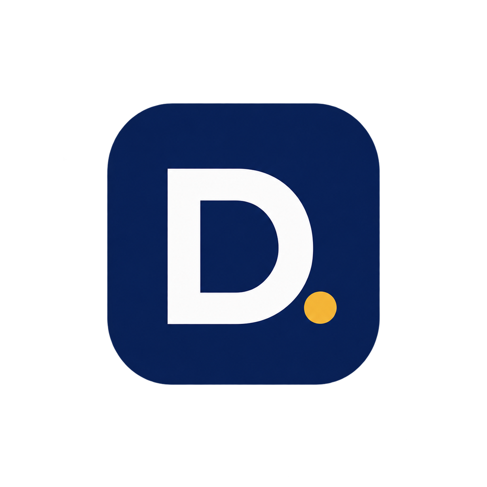

<div align="center">



# DIPC — Digital India Promotion Company

### Company website — Next.js, TypeScript, 3D & motion

[](https://nextjs.org/)
[](https://react.dev/)
[](https://www.typescriptlang.org/)
[](https://tailwindcss.com/)
[](https://threejs.org/)
[](https://vercel.com/)

[](https://github.com/Aryan170911/dipc)

---


> Built on [Aryan170911/PersonalBlog](https://github.com/Aryan170911/PersonalBlog) (template, MIT) — itself forked from [Arfazrll/PersonalBlog](https://github.com/Arfazrll/PersonalBlog).

</div>

---

## Executive Summary

The company website of **Digital India Promotion Company (DIPC)** — an AI solutions company selling websites, AI chatbots and business automation to Indian enterprises. A production-grade, highly interactive Next.js application with 3D visuals, scroll motion, bilingual English/Hindi content, live GitHub stats, and an AI sales assistant that answers from the company data.

---

## System Architecture & Technologies

### Core Framework
- **Next.js 16 (App Router):** Server-side rendering (SSR), static site generation (SSG), and API routes for chatbot, contact, GitHub, Kaggle and WakaTime endpoints.
- **React 19 & TypeScript:** Strict type safety across 50+ custom UI components.

### 3D Graphics & Motion
- **Three.js & React Three Fiber (R3F):** WebGL rendering (interactive 3D badge, backgrounds).
- **Framer Motion & GSAP:** Scroll choreography, micro-interactions and page transitions.
- **Tailwind CSS & Shadcn UI:** Utility-first design system on Radix UI primitives.
- **Lenis:** Smooth, premium scrolling dynamics.

### System Integrations & APIs
- **AI Sales Chatbot:** `/api/chat` builds its context from `portfolio.ts` and answers via Groq (LLaMA) with automatic failover to Google Gemini. Needs `GROQ_API_KEY` (and optionally `GEMINI_API_KEY`); without keys the chat UI is inert.
- **GitHub REST:** Repository statistics, contribution calendar and language breakdown for `NEXT_PUBLIC_GITHUB_USERNAME`. A `GITHUB_TOKEN` raises API rate limits.
- **WakaTime (optional):** Coding-activity cards via `WAKATIME_API_KEY`. Without a key the WakaTime section hides itself instead of showing empty metrics.
- **Kaggle (optional):** Stats via `KAGGLE_USERNAME` / `KAGGLE_API_TOKEN`.
- **Contact form:** Nodemailer over Gmail SMTP using `EMAIL_USER` + `EMAIL_APP_PASSWORD`.
- **Next-Intl:** Bilingual experience — English (`messages/en.json`) and Hindi (`messages/id.json` locale file).

---

## Project Structure

```text
dipc/
├── src/
│   ├── app/                          # Next.js 16 App Router Entry Points
│   │   ├── api/                      # Backend API Routes (chat, contact, github, kaggle, wakatime)
│   │   ├── projects/                 # Services & case-study directory
│   │   ├── experience/               # Company timeline
│   │   ├── skills/                   # Capabilities & tech stack
│   │   ├── achievements/             # Company credentials
│   │   ├── blog/                     # Article renderer (data-driven)
│   │   ├── gallery/                  # Visual archive
│   │   └── contact/                  # Quote form + company FAQs
│   ├── components/
│   │   ├── three/                    # WebGL & R3F Components
│   │   ├── sections/                 # Primary Page Layout Structures
│   │   └── ui/                       # 50+ Custom Shadcn & Animated Primitives
│   ├── data/
│   │   └── portfolio.ts              # Centralized Company Data Store
│   ├── hooks/                        # Custom React Hooks (Performance, CountUp, ...)
│   ├── i18n/                         # Locale settings (en + id/Hindi)
│   └── styles/                       # Global CSS & Tailwind Directives
├── messages/                         # en.json (English) + id.json (Hindi copy)
├── public/                           # Static Assets (DIPC logo, project visuals, 3D models)
├── next.config.ts                    # Next.js Optimization Configuration
└── tailwind.config.ts                # Custom Design System Configurations
```

---

## Key Features

### 1. Interactive 3D & Motion Design
Hardware-accelerated 3D badge, scroll-linked reveals, parallax galleries, magnetic buttons, animated counters and bilingual (EN/HI) UI with a language toggle.

### 2. AI Sales Chatbot
A conversational assistant deployed via `/api/chat`. It builds its context window from the company data in `portfolio.ts`, so updating services, projects or FAQs automatically updates what the bot knows — no separate training step.

### 3. Live Company Stats
The homepage **CompanyStats** band counts up real company numbers (services, deliveries, industries, response promise). GitHub cards show live repository activity when `GITHUB_TOKEN` is configured.

### 4. Company Profile Page
The `/profile` route (linked as “Profile” in navigation) is a placeholder announcing the forthcoming company-profile document, with links to work and contact. Drop the final PDF in and wire the viewer when ready.

### 5. Performance Diagnostics
The `usePerformance` hook evaluates client hardware in real time, disabling intensive WebGL shaders and complex animations on low-power or mobile devices to preserve battery life and framerates.

---

## Customizing Company Content

All editable business content lives in three places — no other files need touching for routine updates:

| What to change | Where |
|---|---|
| Identity, services, timeline, skills, FAQs, blog posts, gallery | `src/data/portfolio.ts` (sections: `personal`, `projects`, `experiences`, `hardSkills`, `faqs`, `blogs`, `gallery`) |
| Every English string on screen | `messages/en.json` (18 namespaces: `hero`, `about`, `ctaSection`, …) |
| Every Hindi string on screen | `messages/id.json` (same shape as `en.json`; keep keys in sync) |
| Homepage numbers band | `CompanyStats` `STATS` array in `src/components/sections/CompanyStats.tsx` |
| Logo / project visuals | `public/dipc-logo.png`, `public/project/` |

---

## Local Development Setup

### Prerequisites
- Node.js >= 18.0.0
- npm >= 9.0.0

### Installation

1. **Clone the repository:**
   ```bash
   git clone https://github.com/Aryan170911/dipc.git
    cd dipc
   ```

2. **Install dependencies:**
   ```bash
   npm install
   ```

3. **Configure Environment Variables:**
   Create a `.env.local` file in the root directory.

   ```env
   # Required for live GitHub stats + showcase identity
   NEXT_PUBLIC_GITHUB_USERNAME=Aryan170911
   # Optional integrations (features stay hidden/inert without them)
   GITHUB_TOKEN=
   WAKATIME_API_KEY=
   GROQ_API_KEY=
   GEMINI_API_KEY=
   KAGGLE_USERNAME=
   KAGGLE_API_TOKEN=
   EMAIL_USER=
   EMAIL_APP_PASSWORD=
   ```

4. **Initialize Development Server:**
   ```bash
   npm run dev
   ```
   Navigate to `http://localhost:3000` to interact with the application. The language toggle (EN/HI) is in the navigation.

### Production Build
Execute the following to compile and serve the optimized application bundle:
```bash
npm run build
npm start
```
Deployment target: **Vercel** (import the repo, add the env vars above, attach the `dipc.site` domain).

---

## Project Showcase Overview

The platform documents **our services and client work**:

| Offering | Highlights | Core Technologies |
|------------|------------|-------------------|
| **Websites & Web Apps** | Business sites, online stores, lead capture | Next.js, React, Tailwind CSS, Node.js |
| **AI Chatbots & Assistants** | Website chat, lead capture, human handover | Python, LangChain, OpenAI |
| **Chat Platform Bots** | WhatsApp & Telegram ordering, support, broadcasts | Node.js, WhatsApp Business API, Telegram Bot API |
| **Business Automation** | Follow-ups, reminders, reports, app integrations | Python, REST APIs, PostgreSQL |

---

## License

This project is licensed under the [MIT License](LICENSE).

<div align="center">
  <p>Maintained by DIPC · Built on PersonalBlog template (MIT)</p>
</div>
